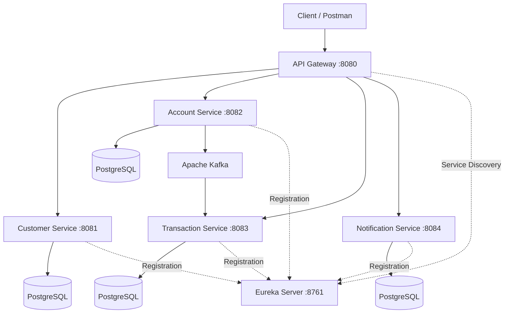

# 🏦 BankEase – Microservices-Based Banking System

BankEase is a backend banking application built using **Spring Boot and Microservices Architecture**. The project separates banking functionalities into independent services to improve modularity, maintainability, scalability, and communication between services.

The application uses **Spring Boot, PostgreSQL, Apache Kafka, Netflix Eureka, Spring Cloud Gateway, and Docker** to build and run the microservices-based system.

## 🚀 Project Overview

BankEase provides REST APIs for customer management, account management, transaction management, and notifications. The API Gateway provides a single entry point for client requests, while Eureka supports service registration and discovery.

Apache Kafka is used for asynchronous communication between services, particularly for transaction events.

### Key Features

- Customer management through REST APIs.
- Bank account management.
- Transaction history and transaction event processing.
- Notification service integration.
- API Gateway for routing client requests.
- Service registration and discovery using Netflix Eureka.
- Asynchronous messaging using Apache Kafka.
- PostgreSQL database integration.
- Docker-based containerization of services.
- API testing using Postman.

## 🏗️ System Architecture



*Note: Database usage is shown conceptually. The actual database configuration depends on each service's application properties. The diagram illustrates the intended architecture.*

## 🧩 Microservices

| Service              | Responsibility                                                            | Port |
| -------------------- | ------------------------------------------------------------------------- | ---: |
| Customer Service     | Manages customer information                                              | 8081 |
| Account Service      | Handles bank account operations                                           | 8082 |
| Transaction Service  | Stores and retrieves transaction records and processes transaction events | 8083 |
| Notification Service | Provides notification-related APIs                                        | 8084 |
| API Gateway          | Routes requests to backend services                                       | 8080 |
| Eureka Server        | Registers services and supports service discovery                         | 8761 |

## 🛠️ Technology Stack

| Technology           | Purpose                                    |
| -------------------- | ------------------------------------------ |
| Java 21              | Programming language                       |
| Spring Boot          | Backend application development            |
| Spring Data JPA      | Database access                            |
| PostgreSQL           | Relational database                        |
| Apache Kafka         | Asynchronous event messaging               |
| Netflix Eureka       | Service registration and discovery         |
| Spring Cloud Gateway | API routing                                |
| Docker               | Containerization                           |
| Maven                | Dependency management and build automation |
| Postman              | REST API testing                           |
| Git and GitHub       | Version control and source code hosting    |

## 🔄 How the System Works

1. A client sends an HTTP request to the API Gateway.
2. The Gateway routes the request to the appropriate microservice.
3. The selected service executes its business logic and interacts with its configured database.
4. When an account operation produces a transaction event, the Account Service publishes the event to Kafka.
5. The Transaction Service consumes the event and saves the transaction information in its database.
6. Eureka maintains service registration and supports service discovery.
7. The Notification Service exposes notification-related functionality through its API.

## 🌐 API Endpoints

The following endpoints were tested locally through the API Gateway.

**Base URL:** `http://localhost:8080`

| Method | Endpoint         | Purpose                       |
| ------ | ---------------- | ----------------------------- |
| GET    | `/customers`     | Retrieve customer records     |
| GET    | `/accounts`      | Retrieve account records      |
| GET    | `/transactions`  | Retrieve transaction records  |
| GET    | `/notifications` | Retrieve notification records |

Examples:

```http
GET http://localhost:8080/customers
GET http://localhost:8080/accounts
GET http://localhost:8080/transactions
GET http://localhost:8080/notifications
```

These are the tested GET endpoints documented for the current setup. Other available operations depend on the controllers implemented in each service.

## ⚙️ Prerequisites

Install the following tools before running the project:

- Java Development Kit (JDK) 21
- Docker Desktop
- PostgreSQL
- Git
- Postman (optional, for API testing)

Ensure the required databases, credentials, ports, and environment variables are configured for your local environment.

## ▶️ Run the Project Locally

### 1. Clone the repository

```bash
git clone <YOUR_GITHUB_REPOSITORY_URL>
cd BankEase-Microservices
```

Replace `<YOUR_GITHUB_REPOSITORY_URL>` with your actual GitHub repository URL.

### 2. Start Docker Desktop

Make sure Docker Desktop is running.

### 3. Configure environment variables

Configure the required database credentials and other service-specific settings. For example, if the Transaction Service uses `DB_PASSWORD`, provide that variable through your local environment or Docker Compose configuration.

**Security:** Do not commit database passwords, API tokens, or other secrets to GitHub.

### 4. Start the services

From the directory containing `docker-compose.yml`, run:

```bash
docker compose up -d
```

### 5. Verify the containers

```bash
docker compose ps
```

Check the logs if a service does not start:

```bash
docker compose logs -f
```

### 6. Access the services

| Component        | Local URL                             |
| ---------------- | ------------------------------------- |
| API Gateway      | `http://localhost:8080`               |
| Eureka Dashboard | `http://localhost:8761`               |
| Customer API     | `http://localhost:8080/customers`     |
| Account API      | `http://localhost:8080/accounts`      |
| Transaction API  | `http://localhost:8080/transactions`  |
| Notification API | `http://localhost:8080/notifications` |

Make sure the host PostgreSQL server is running if your Docker configuration connects to it using `host.docker.internal`.

## 🐳 Docker and Kafka

Each application has a Docker image, allowing the services to run in containers.

Kafka supports asynchronous communication between the Account Service and Transaction Service through transaction events.

The Kafka broker uses the internal Docker network address `kafka:29092` for container-to-container communication in the local setup. The external listener is configured for local access at `localhost:9092`.

## 🧪 Testing

Use Postman to test the REST APIs.

1. Start the Docker containers and PostgreSQL.
2. Confirm the services have started successfully.
3. Verify service registration on the Eureka dashboard.
4. Send GET requests to the API Gateway endpoints.
5. Perform a supported account operation that generates a transaction event.
6. Verify that the Transaction Service consumes the event and stores the transaction record.

## ☁️ Deployment

The current project is configured for local execution using Docker.

For public deployment, the services and their dependencies must be configured for the selected hosting platform. This includes:

- Deploying the API Gateway and microservices.
- Configuring a reachable PostgreSQL database.
- Providing a reachable Kafka broker.
- Configuring service discovery and internal service URLs.
- Setting environment variables and secrets securely.
- Exposing only the necessary public endpoints.

A local URL such as `http://localhost:8080` is accessible on your own machine; it is not a public production URL. A hosted API URL can be added here after deployment.

## 🔒 Security Considerations

- Keep database credentials in environment variables.
- Never push passwords, private keys, or tokens to GitHub.
- Restrict access to internal services and infrastructure.
- Add appropriate authentication and authorization before exposing banking APIs publicly.
- Use HTTPS for public deployments.

## 🎯 Project Objectives

- Understand microservices architecture using Spring Boot.
- Implement REST APIs for banking-related operations.
- Integrate PostgreSQL with backend services.
- Implement event-driven communication with Apache Kafka.
- Use Eureka for service discovery.
- Route requests through an API Gateway.
- Containerize applications using Docker.
- Test and validate backend APIs using Postman.

## 🔮 Future Enhancements

- JWT-based authentication and role-based authorization.
- Secure money transfers between accounts.
- Input validation and centralized exception handling.
- Improved notification delivery and retry handling.
- Distributed tracing and centralized logging.
- Automated unit and integration tests.
- Cloud deployment with managed databases and messaging infrastructure.
- API documentation using Swagger/OpenAPI.

##

---

*BankEase is an educational microservices project demonstrating backend service development, API routing, database integration, event-driven communication, and containerization.*
